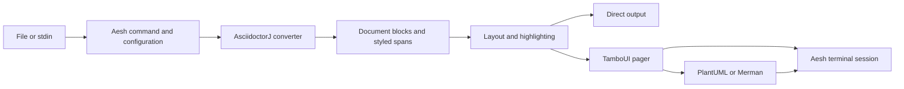

<!-- SPDX-License-Identifier: MPL-2.0 -->

# Architecture

glow-adoc converts AsciiDoc into a terminal-independent document model, lays that model out for a terminal width, and displays it through an embedded pager or direct output.

## Data flow

## Module boundaries

| Module                | Owns                                                           |
| --------------------- | -------------------------------------------------------------- |
| `document`            | Blocks, spans, styles, appearance and safe text/link handling  |
| `asciidoctor`         | AsciidoctorJ lifecycle, local includes and custom conversion   |
| `highlight`           | The `Highlighter` contract returning document spans            |
| `highlight-lumis4j`   | Lumis4J lifecycle, language/theme selection and SGR decoding   |
| `render`              | Width-aware layout and rendered lines with block positions     |
| `terminal`            | Aesh connection, reply filtering, colours, ANSI and Kitty      |
| `pager`               | TamboUI event loop, scrolling, search and image placements     |
| `diagrams`            | PlantUML, bounded Merman processes and temporary assets        |
| `cli`                 | Arguments, TOML configuration and application assembly         |
| `cli-jvm`             | Compatibility bootstrap, Shadow packaging, install and AOT     |
| `cli-native`          | Experimental complete-application Native Image build           |

`document` has no parser, terminal or UI dependency. The parser owns AsciidoctorJ nodes; callers receive immutable document records. `render` consumes the common highlighter contract, while the CLI selects the Lumis4J implementation explicitly. There is no runtime plugin registry.

Asciidoctor's converter callbacks produce a private XML vocabulary so inline substitutions retain their styling boundaries. `AsciiDocReader` parses that vocabulary into blocks and spans using an XML parser with external entities disabled. This intermediate representation is internal to the adapter; it is not HTML or a public interchange format.

## Reading and terminal lifecycle

The command resolves CLI arguments over user configuration and defaults, loads one document, and selects direct output or paging. Keyboard input uses a terminal connection independently of document stdin. Direct output does not query the terminal or transmit graphics.

The pager uses TamboUI's Aesh backend. One connection carries keyboard input and terminal replies. Reply filtering prevents OSC and graphics responses from becoming pager commands. The session queries foreground/background colours and selected palette entries, supports mode 2031 notifications, and falls back to bounded polling and manual refresh. Explicit themes override automatic appearance.

Layout retains block positions for resize recovery. Code and tables remain horizontally scrollable. Image placements use queried cell dimensions when available, with an approximate fallback. Kitty image IDs belong to the session and are removed when placements change or the reader exits. Terminal modes and cursor state are restored through resource cleanup.

## Assets and failure handling

PlantUML's MIT artifact provides embedded PNG rendering with Smetana. Merman runs as an optional external executable, discovered through configuration or PATH. A missing or failed diagram renderer leaves the diagram source available to the highlighter. Unsupported image formats retain their description and path.

Includes and image paths are checked against the document directory, including resolved symbolic links. PlantUML uses its sandbox profile and rejects include/import/theme directives. Merman execution has a deadline and bounded output; active child processes are cancelled on cleanup. These controls do not provide an operating-system sandbox.

## Build and distribution

The included `build-logic` build owns Java conventions and small packaging tasks. The Gradle daemon runs on Java 27; application bytecode targets Java 25. A Java 8 bootstrap reports incompatible runtimes before loading the application.

Shadow produces an executable JVM jar with service registrations and JRuby resources. A separate task prepends a POSIX launcher to a copy. At launch time the script selects a compatible installed JVM through mise, SDKMAN!, asdf-vm, jenv, jabba, `JAVA_HOME`, then PATH. It performs no JDK installation. The install task copies that artifact to `~/.local/bin/glow-adoc`. AOT training uses the final jar and the daemon's exact JDK; caches are specific to that application, JDK build and platform.

Project source uses MPL 2.0. Dependencies retain their licences and notices. The jars include project licence documents and collected upstream notices; see [THIRD-PARTY.md](THIRD-PARTY.md).

## Current limits

The supported interactive targets are macOS and Linux. Native Image compilation has succeeded locally, but JRuby startup remains blocked by missing runtime metadata. Real-terminal graphics, SSH and visual correctness require manual verification. A future document browser can reuse the existing document, layout and pager foundations without changing the parser contract.
