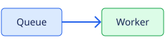

// SPDX-License-Identifier: MPL-2.0

== Local diagrams and images

.Task completion sequence
[plantuml]
----
@startuml
Client -> Worker: submit
Worker -> Queue: enqueue
Queue --> Worker: result
Worker --> Client: complete
@enduml
----

.Queue flow
[mermaid]
----
flowchart LR
    Request --> Queue --> Worker --> Result
----

.Worker queue

